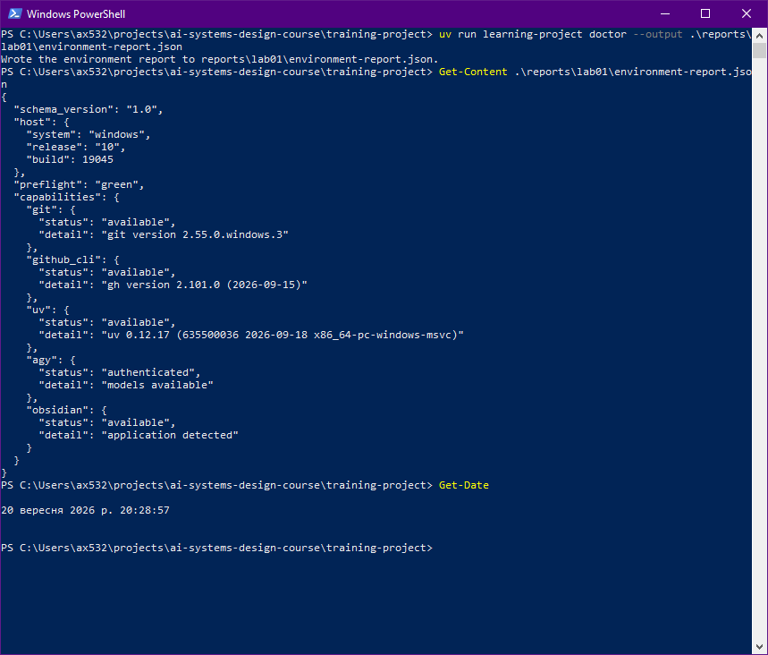
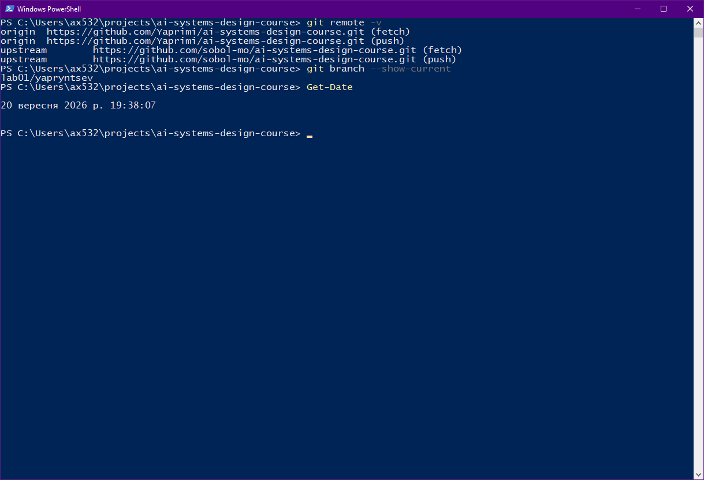
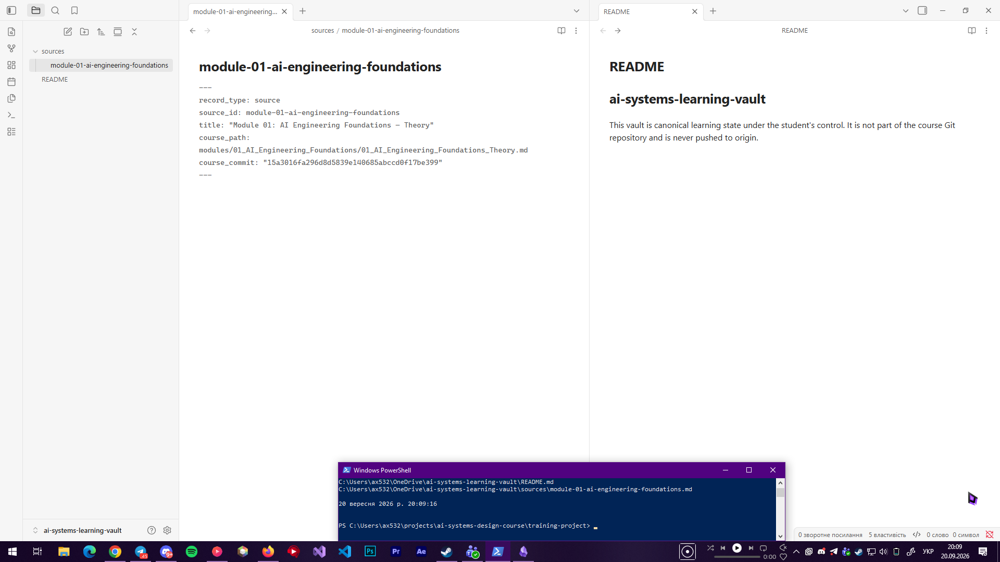
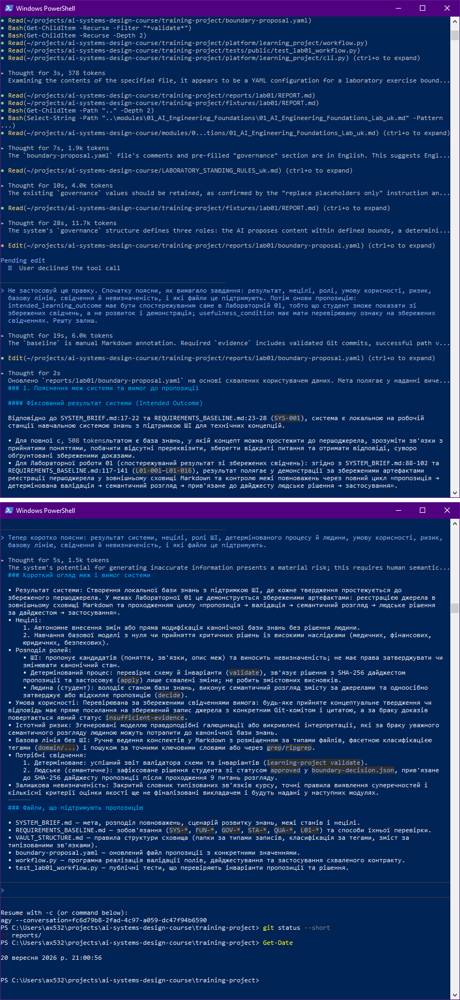
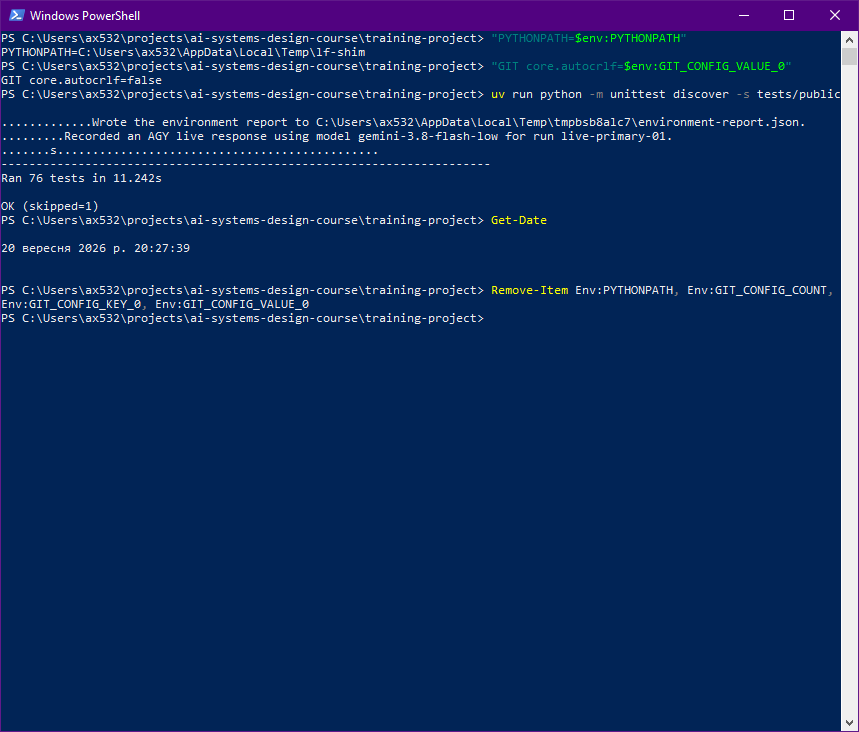
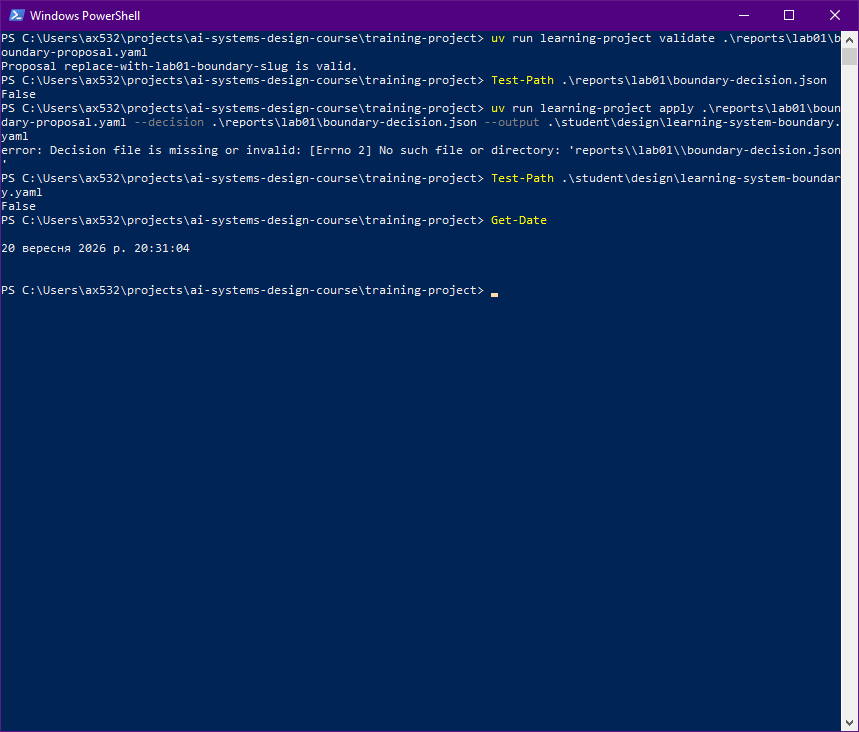
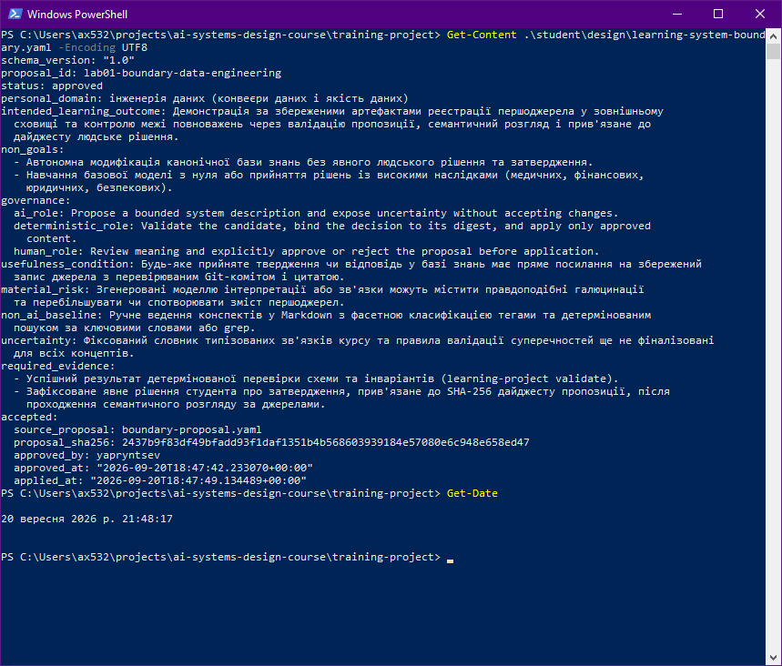

# Лабораторна робота 01

Заповнити кожен розділ власними словами українською мовою. Не вилучати заголовки. У потрібних розділах додати знімки екрана відносними шляхами Markdown до файлів у `screenshots/` із точними іменами, названими в лабораторній роботі. Підпис ставити наступним рядком після зображення.

## Ідентифікація подання

- URL форку: https://github.com/Yaprimi/ai-systems-design-course
- Назва гілки: lab01/yapryntsev
- Повний хеш коміту: [ДОЗАПОВНИТИ після `git commit` на кроці 10: результат `git rev-parse HEAD`, 40 символів]

Обліковий запис Windows на знімках — `ax532`, обліковий запис GitHub — `Yaprimi`, ідентифікатор студента — `yapryntsev`.

## Середовище

Робоча станція: Windows 10 22H2 (збірка 19045), PowerShell 5.1. Лабораторна розрахована на Windows 11, тому `winget configure` відхилив конфігурацію (`OsVersion`, потрібна збірка від 22000); відмова записана в `provision.log`. Файл конфігурації я не редагував, а встановив ті самі чотири пакунки вручну через `winget install`: `Git.Git`, `GitHub.cli`, `astral-sh.uv`, `Obsidian.Obsidian`. Це відхилення від лабораторної.

Встановлення я запустив двічі. Перший раз установилися GitHub CLI 2.101.0, uv 0.12.17 та Obsidian 1.13.7 (Git 2.55.0.3 уже був). Другий раз для всіх пакунків було «No available upgrade found»: нічого не перевстановилося, версії не змінилися. Це замінює друге застосування конфігурації.

Проблеми: (1) `uv --version` показував 0.9.28 замість 0.12.17, бо раніше в `PATH` стоїть `uv.exe` з чужого проєкту ComfyUI; я не видаляв його, а в кожному вікні першим рядком додаю `WinGet\Links` на початок `$env:Path`.

`learning-project doctor` дав `"preflight": "green"`; `git`, `github_cli`, `uv`, `obsidian` — `available`, `agy` — `authenticated`. У `environment-report.json` чесно записано Windows 10, збірка 19045.

Рисунок — `02-workstation-capabilities.png`

## Власність репозиторію

Я створив форк `sobol-mo/ai-systems-design-course` під своїм обліковим записом GitHub (`Yaprimi`) і клонував його в `C:\Users\ax532\projects`. `origin` — мій форк `https://github.com/Yaprimi/ai-systems-design-course.git`, `upstream` — оригінал `https://github.com/sobol-mo/ai-systems-design-course.git`. Роботу веду в особистій гілці `lab01/yapryntsev`, не в `main`. Зміни надсилаю лише в `origin`.

Рисунок — `01-git-remotes.png`

## Зовнішнє сховище Markdown-файлів

Сховище Obsidian `ai-systems-learning-vault` лежить у `C:\Users\ax532\OneDrive\ai-systems-learning-vault`, тобто `external to repository`: воно поза клоном, не відстежується Git і не надсилається в `origin`. Захист поза пристроєм: папка синхронізується з OneDrive (біля неї зелена галочка), тож копія поза пристроєм є. Це синхронізація, а не повноцінне резервне копіювання.

У сховищі два файли: `README.md` і `sources/module-01-ai-engineering-foundations.md` з YAML-передмовою (шлях до теорії модуля та повний `course_commit`, який збігається з `git rev-parse HEAD` у клоні). Концептів, графового і векторного індексів немає. Початкову нотатку Obsidian я видалив.

Рисунок — `05-external-vault.png`

## Шлях пропонувача

Шлях агента: пропонувачем був Antigravity CLI (`agy` 1.2.7, модель Gemini 3.8 Flash), сеанс 20 вересня 2026 року в `training-project`. Обрана `personal_domain`: інженерія даних (конвеєри даних і якість даних) — нечутлива технічна сфера з моєї спеціальності, що не збігається з темою курсу.

На знімку 04 видно виклики агента: `Read`, `Bash` (лише команди пошуку й читання) і один `Edit` для `reports/lab01/boundary-proposal.yaml`; `decide` і `apply` серед них немає. Першу правку я відхилив: `intended_learning_outcome` описував мету всієї системи, а `usefulness_condition` не мала перевірної ознаки на збережених свідченнях. Виправлену другу правку прийняв. Пояснення агент дав після правки, а не до неї. Після виходу з `agy` `git status --short` показав лише `?? reports/`.

Рисунок — `04-proposer-session.png`

## Семантичний розгляд

Розгляд виконано після успішної `validate` (`Proposal lab01-boundary-data-engineering is valid.`) і до запуску `decide`. Пропозиція має `proposal_id` `lab01-boundary-data-engineering`.

1. **Система збережена, `personal_domain` лише розширення?** Так. «Інженерія даних» стоїть тільки в `personal_domain`. Решта полів описує систему курсу: реєстрацію першоджерела в зовнішньому сховищі, валідацію, семантичний розгляд і рішення, прив'язане до дайджесту. Висновок: підходить.
2. **Результат спостережуваний?** Так. Результат описує, що можна показати за збереженими артефактами: зареєстроване джерело і контроль межі повноважень через валідацію, розгляд і рішення. Це не «використати ШІ». Висновок: підходить.
3. **Нецілі не дають розширитися до повної системи чи рішень із високими наслідками?** Здебільшого так. Перша неціль забороняє автономну зміну бази знань без рішення людини, друга виключає навчання моделі з нуля та рішення з високими наслідками (медичні, фінансові, юридичні, безпекові). Прямої фрази про повну систему в промисловій експлуатації немає: це слабке місце, але його вже обмежують `SYSTEM_BRIEF.md` і сама межа Лабораторної 01. Висновок: достатньо, слабке місце зазначаю.
4. **Розподіл ролей?** Так. ШІ лише пропонує опис і показує невизначеність, детермінований код перевіряє, прив'язує рішення до дайджесту й застосовує лише затверджене, а людина розглядає зміст і затверджує або відхиляє. Висновок: підходить.
5. **Умова корисності перевірна?** Так. Кожне прийняте твердження має посилання на збережений запис джерела з перевірюваним Git-комітом і цитатою, а такий запис у сховищі є. Висновок: підходить.
6. **Ризик правдоподібний?** Так. Правдоподібні галюцинації моделі та спотворення змісту першоджерел. Слабке місце: не сказано, що валідація може пройти, а людина затвердить поверхнево. Висновок: підходить.
7. **Базова лінія без ШІ проста і закриває частину результату?** Так. Ручні конспекти в Markdown із тегами й пошук `grep` без моделі вже закривають реєстрацію джерел і пошук цитат. Висновок: підходить.
8. **Свідчення охоплюють детерміновану частину й розгляд людиною?** Так. Перший пункт — результат `learning-project validate`, другий — явне рішення студента, прив'язане до SHA-256 дайджесту після семантичного розгляду. Висновок: підходить.
9. **Невизначеність називає нерозв'язане?** Так. Вона каже, що словник типізованих зв'язків курсу та правила перевірки суперечностей ще не фіналізовані. Слабке місце: це стосується ширшої бази знань, а не безпосередньо цієї лабораторної. Висновок: підходить.

## Розподіл повноважень

У звичайній системі ШІ лише пропонує, бо модель може помилятися правдоподібно (галюцинувати, спотворювати джерела) і не несе відповідальності за наслідки. Структуру перевіряє детермінований код (`validate`), а затверджує людина, яка розуміє мету й відповідає за результат. У моєму сеансі ця межа витримана: `agy` лише читав файли та редагував пропозицію, першу правку я відхилив, `decide` і `apply` виконав сам. Значення `--by` — це моя атрибуція; CLI особу не автентифікує.

## Корисність і базова лінія без ШІ

ШІ корисний тим, що швидко складає чернетку пропозиції за кількома файлами вимог. Але перша версія агента була формально правильною, а змістовно слабкою, тому результат потребує розгляду людиною. Простіша базова лінія: ручні конспекти в Markdown із тегами й пошук `grep`, а також заповнення полів пропозиції вручну. Вона вже закриває реєстрацію джерел і пошук цитат без моделі.

## Особиста предметна сфера як пізніше розширення

`personal_domain` — «інженерія даних (конвеєри даних і якість даних)»: нечутлива технічна сфера, що не потребує особистих даних. У Лабораторній 01 вона лише записана в цьому полі і нічого не змінює: за `SYSTEM_BRIEF.md` вона фіксує можливу область пізнішого розширення, але не обирає іншу систему. Запланований навчальний результат стосується реєстрації джерела курсу, перевірки пропозиції та рішення, тобто фіксованої навчальної системи знань, а не роботи з новою предметною областю.

## Проєктний компроміс

Компроміс між контролем людини і швидкістю. Вимога, щоб ШІ лише пропонував, а кожну правку перевіряла людина, коштує часу: моя перша правка агента була відхилена, довелося повторювати цикл і уважно читати кожен запит дозволу. Натомість пропозиція справді відповідає лабораторній, а рішення залишається за мною. Для навчальної системи, де важливіша правильність, ніж затримка, цей обмін виправданий.

## Детерміновані перевірки

**Публічні тести.** Повний запуск `tests/public` спершу мав падіння. Тести Лабораторної 01 і `prepare-report` проходять; падали 18 тестів Лабораторної 02, бо на Windows `Path.write_text()` записує `\n` як `\r\n`, а ті тести порівнюють файли побайтово. Файли курсу, тести й глобальні налаштування Git я не змінював. Для локального запуску використав підмінку `sitecustomize.py` у `%TEMP%` (через `PYTHONPATH`) і `core.autocrlf=false` лише для клону. З нею результат `Ran 76 tests ... OK (skipped=1)`; один тест пропущено, бо він для POSIX Bash. Знімок 03 зроблено з цією підмінкою, її видно у верхніх рядках знімка.

**Відмова передчасного `apply`.** `validate` підтвердив стартову пропозицію, а `apply` без рішення завершився помилкою `Decision file is missing or invalid`; `learning-system-boundary.yaml` не створено (`Test-Path` — `False`).

**Прийнятий контракт.** Після семантичного розгляду я виконав `decide --approve --by "yapryntsev"` (`Approved lab01-boundary-data-engineering as yapryntsev.`), а потім `apply`. Контракт `student\design\learning-system-boundary.yaml` має `status: approved` і розділ `accepted` з `proposal_sha256`, `approved_by: yapryntsev`, `approved_at` 2026-09-20T18:47:42Z.

**Чому валідатор не доводить якості.** `validate` перевіряє лише структуру (поля, `status`, формат `proposal_id`), а не зміст. Пропозиція може бути структурно коректною, але описувати не ту мету або мати неперевірну умову корисності. Це бачить лише семантичний розгляд людиною.

Рисунок — `03-public-tests.png`

Рисунок — `06-premature-apply-refused.png`

Рисунок — `07-accepted-contract.png`

## Відновлення

Середовище: чотири пакунки встановлюються командами `winget install --id ... -e --source winget`, `agy` — офіційним скриптом Google, `uv sync` у `training-project` створює `.venv`. Артефакти проєкту (`student/` і `reports/lab01/`) зберігаються в Git у гілці `lab01/yapryntsev` і відновлюються клонуванням форку. Сховище Markdown не входить до Git; його два файли відтворюються з `course_commit` і шляху теорії. Копія поза пристроєм є завдяки синхронізації OneDrive.
