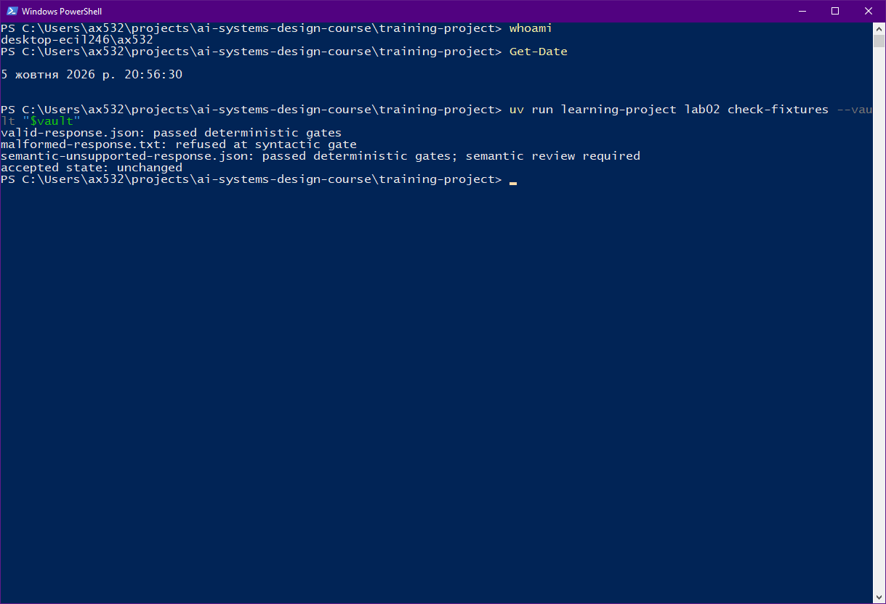
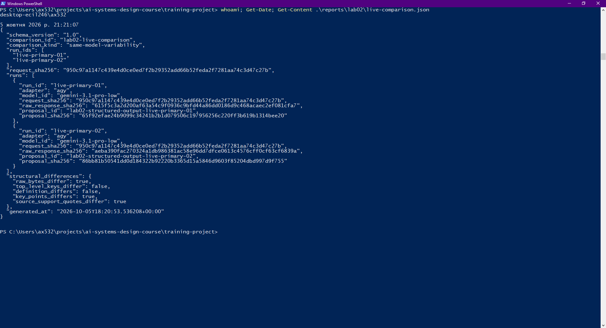
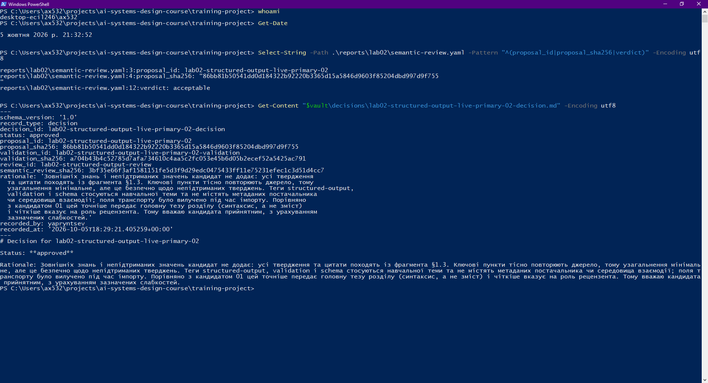
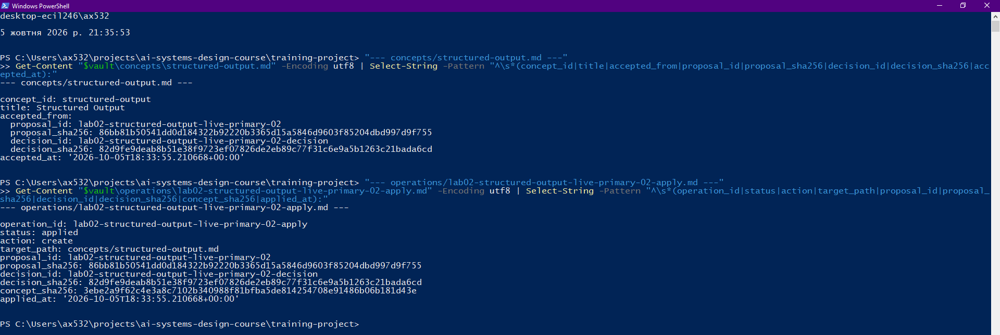
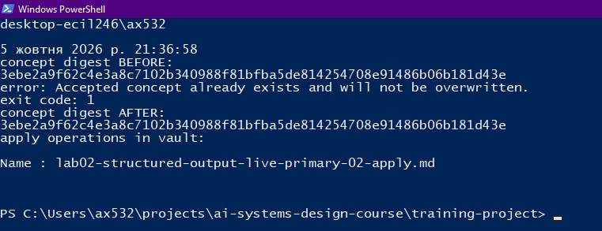
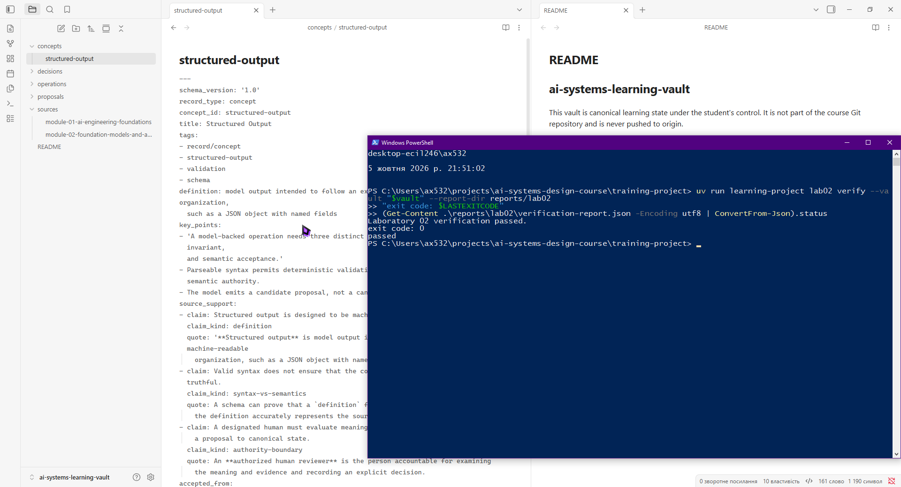

# Лабораторна робота 02

Заповнити кожен розділ власними словами українською мовою. Не вилучати заголовки. Описати перебіг роботи, виконані дії, спостережені результати та причини прийнятих рішень. Залишити наведені відносні шляхи до знімків екрана й підписи з точними іменами файлів. На кожному знімку мають бути видимі обліковий запис операційної системи або GitHub і системна дата; підпис не замінює цієї видимої ідентифікації.

## Ідентифікація подання

- URL форку: https://github.com/Yaprimi/ai-systems-design-course.git
- Назва особистої гілки: lab02/yapryntsev
- Повний хеш коміту зі свідченнями:

## Початковий стан і реєстрація джерела

Перед початком роботи я виконав Лабораторну роботу 01, тому мав форк з `origin` і `upstream`, робоче середовище `training-project` та зовнішнє сховище Markdown-файлів поза клоном курсу. На початку сховище містило `README.md` і `sources/module-01-ai-engineering-foundations.md`, а файлу `concepts/structured-output.md` ще не було. Перед першою командою я синхронізував `main` з `upstream` і створив особисту гілку `lab02/yapryntsev`, у якій виконував всю роботу.

Далі я зареєстрував джерело командою `register-source`. Вона записала у сховище джерело `module-02-foundation-models-and-ai-application-architecture` і фрагмент `module-02-1-3-structured-output-controls-v1` (розділ §1.3 теорії модуля 02) з дайджестом SHA-256 `7d7d5ce2d33d4852985c2337292fbf257ae554cefbbf7e4b9e4ef8090a797063`, а також точний коміт клону курсу (`course_commit`) на момент реєстрації.

`course_commit` є базовим станом джерела, а не комітом подання, бо він показує, з якою саме версією матеріалів курсу працював робочий процес. Остаточний перевіряльник порівнює файли, що належать upstream, саме з цим комітом. Мій звіт і свідчення комітяться пізніше, у шляхах `reports/`, тому повторна реєстрація джерела після цього змінила б прив'язаний ланцюг і зламала б перевірку.

## Детерміновані шлюзи

Я запустив `check-fixtures`, яка перевіряє три тестові відповіді в тимчасовому стані, не торкаючись сховища. Результат був таким:

- `valid-response.json` пройшов синтаксичний шлюз і шлюз детермінованих інваріантів;
- `malformed-response.txt` відхилено на синтаксичному шлюзі, бо це не одне коректне JSON-значення, тому запис пропозиції навіть не створюється;
- `semantic-unsupported-response.json` пройшов обидва детерміновані шлюзи, але команда окремо вказала, що потрібен семантичний розгляд.

Прийнятий стан після перевірки залишився незмінним. Третя фікстура найкраще показує, чому успішні синтаксична перевірка та перевірка інваріантів не дають семантичного схвалення: вони відповідають на питання про форму (чи розбирається відповідь, чи є потрібні поля, ідентифікатори й дозволені значення). Чи правильно визначення передає джерело і чи цитата справді підтримує твердження, може оцінити лише людина.

Рисунок — `01-offline-gates.png`

## Живі запуски та порівняння

Обидва живі запуски виконано через адаптер `agy` (Antigravity CLI) з моделлю `gemini-3.1-pro-low`: `live-primary-01` і `live-primary-02`. Запит у них побітово однаковий, спільний `request_sha256` дорівнює `950c97a1147c439e4d0ce0ed7f2b29352add66b52feda2f7281aa74c3d47c27b`.

Порівняння класифіковано як `same-model-variability`, бо в метаданих обох запусків збігаються і адаптер, і модель. Класифікація випливає із записаних метаданих, а не з того, чи відрізняються відповіді.

Отримати відповідь вдалося не одразу. `gemini-3.8-flash-medium` спробував виконати shell-команду, яку headless-режим автоматично заблокував, тому відповідь була порожньою. Моделі `gemini-3.8-flash-low`, `gemini-3.7-flash-low` і `gemini-3.1-pro-low` у кількох спробах повертали у полі `response` два JSON-об'єкти замість одного, і адаптер відхиляв такий результат, не залишаючи часткових свідчень. Тому я обрав `gemini-3.1-pro-low`, яка вже давала один об'єкт, і для другого запуску повторював команду, поки вона не спрацювала (третя спроба).

Конкретна відмінність між кандидатами: визначення однакове, але відрізняються ключові пункти та цитати. Кандидат 01 для `syntax-vs-semantics` цитує речення про JSON mode, а для `authority-boundary` реченням про те, що модель видає кандидата, а не канонічний запис. Кандидат 02 для `syntax-vs-semantics` цитує речення про те, що схема доводить наявність поля `definition`, але не відповідність джерелу, а для `authority-boundary` речення про уповноваженого рецензента. Це не доводить, що причиною була лише вибірка моделі, і одного порівняння для такого висновку недостатньо.

Рисунок — `03-live-comparison.png`

## Семантична коректність і повноваження

Успішний `validate` доводить лише, що кандидат правильно сформований: потрібні поля є, ідентифікатори й значення допустимі, а кожна цитата є точним підрядком зареєстрованого фрагмента. Схема на стороні постачальника діє на тому самому рівні й гарантує форму, а не зміст. Цитата може бути точною і водночас не підтримувати твердження, до якого її прив'язано, а визначення може мати правильний вигляд і спотворювати джерело.

Повноваження ухвалювати рішення має уповноважений людський рецензент, у цій лабораторній роботі це я як студент. Модель лише пропонує кандидата й не має права записувати прийнятий стан. Детермінований код перевіряє структуру й не схвалює жодного кандидата та не змінює канонічних знань. Операція застосування записує прийнятий стан, але лише коли рішення затверджене, кандидат походить від живої відповіді, джерело не змінилося, а цільове поняття ще не існує.

## Семантичний розгляд і рішення

Я порівняв обох кандидатів із фрагментом §1.3 і обрав кандидата 02 (`lab02-structured-output-live-primary-02`). Його визначення майже дослівно збігається з джерелом, а цитати точно підтримують відповідні `claim_kind`. Ключові пункти зосереджені на головній ідеї розділу: три шлюзи і те, що ні синтаксис, ні детермінована валідація не мають семантичних повноважень. Метаданих постачальника чи середовища взаємодії у кандидаті немає, бо поля транспорту було вилучено під час імпорту.

Я також зафіксував слабкі місця: твердження для `authority-boundary` згадує просування до канонічного стану, чого сама цитата не містить, а текст кандидата не каже явно, що прийнятий стан записує окрема операція застосування. Я вважав, що ці недоліки не роблять кандидата непридатним, тож вердикт `acceptable`. Кандидата 01 я не обрав, бо його цитата для `authority-boundary` описує лише роль моделі, а ключові пункти не формулюють головну тезу про синтаксис і зміст.

Рішення прив'язане до точного кандидата та результату його перевірки: у ньому записано дайджест пропозиції `86bb81b5…f755`, дайджест перевірки `a704b43b…c791` і дайджест розгляду `3bf35e66…d4cc7`. Якби змінився будь-який із цих файлів, дайджест перестав би збігатися, і рішення не можна було б застосувати до іншого тексту.

Рисунок — `04-review-decision.png`

## Прив’язки SHA-256

- **Джерело і фрагмент.** Дайджест фрагмента §1.3 (`7d7d5ce2…7063`) і дайджест джерела з'єднують запис у сховищі з точним текстом, з якого вимагалися цитати.
- **Запит і відповідь.** `request_sha256` (`950c97a1…c27b`) фіксує побітово однаковий запит для обох запусків, а `raw_response_sha256` (для запуску 02 `aeba390f…839a`) фіксує точні байти відповіді моделі.
- **Пропозиція і перевірка.** Дайджест пропозиції (`86bb81b5…f755`) пов'язує файл кандидата з результатом `validate`, а `validation_sha256` (`a704b43b…c791`) фіксує сам результат перевірки.
- **Розгляд і рішення.** Розгляд містить дайджести пропозиції та перевірки, а рішення містить `semantic_review_sha256` (`3bf35e66…d4cc7`).
- **Рішення і прийняте поняття.** У `accepted_from` поняття записано дайджести пропозиції та рішення (`82d9fe9d…a6cd`), а запис операції додатково містить `concept_sha256` (`3ebe2a9f…d43e`).

Ці дайджести не доводять, що саме зовнішня модель справді виконала виведення: метадані запуску декларовані мною, і в них прямо зазначено, що це не криптографічний доказ. Вони також нічого не кажуть про семантичну правильність кандидата, бо збіг хешів показує лише, що файли не змінювалися після розгляду.

## Контрольоване застосування

Команда `apply` створила канонічне поняття `concepts/structured-output.md` і єдиний запис операції `operations/lab02-structured-output-live-primary-02-apply.md` зі статусом `applied`. Записати прийнятий стан дозволили затверджене рішення, вердикт розгляду `acceptable`, успішна перевірка, походження від живого запуску та відсутність поняття до цього моменту. У понятті `accepted_from` посилається на дайджести пропозиції та рішення, тож видно, який саме кандидат був прийнятий.

Рисунок — `05-controlled-apply.png`

## Відмова без зміни прийнятого стану

Я запустив ту саму команду `apply` вдруге. Вона завершилася зі статусом виходу 1 і повідомленням, що прийняте поняття вже існує й не буде перезаписане. У сховищі залишився рівно один запис `*-apply.md`. Дайджест `concepts/structured-output.md` до й після спроби був однаковий: `3ebe2a9f62c4e3a8c7102b340988f81bfba5de814254708e91486b06b181d43e`.

Рисунок — `02-refusal-unchanged.png`

## Проєктний компроміс

Під час роботи я побачив, що деякі моделі нестабільно повертають відповідь у потрібному форматі: для другого запуску довелося повторювати команду тричі. Кожна спроба коштує часу й, можливо, квоти, але детермінований адаптер відхиляє погану відповідь безкоштовно й без часткових свідчень. Дешевша модель може частіше помилятися у структурі, і ці помилки ловлять недорогі детерміновані шлюзи. Семантичні помилки вони не ловлять, і для них потрібен людський розгляд, який найдорожчий за часом. Тому для реального проєкту я б не економив на детермінованих шлюзах, бо вони дешеві й відсікають помилки форми, а дорогий людський розгляд залишав би лише для кандидатів, що вже пройшли автоматичні перевірки.

## Захист облікових і платіжних даних

Для живих запусків я користувався лише Antigravity CLI, який уже авторизований у моєму середовищі. Ключів API у командах, змінних середовища проєкту чи файлах я не вводив, тому в Git, звіт і свідчення вони потрапити не могли. Запасний шлях OpenRouter не використовувався. Оскільки OpenRouter не використовувався, перевірка банківської картки на його стороні не потрібна, а дані картки я не вводив ні в команди, ні в проєкт, ні у звіт. На знімках екрана немає облікових даних, токенів, діалогів автентифікації чи стороннього вмісту сховища.

## Канонічний, аудиторський і похідний стан

Канонічним прийнятим знанням є файл `concepts/structured-output.md` у зовнішньому сховищі. Незмінними свідченнями є `model-request.json`, `raw-response.txt` і `run-metadata.json` кожного запуску, пропозиції в `proposals/`, рішення в `decisions/`, запис операції в `operations/` та семантичний розгляд `semantic-review.yaml`. Похідними результатами, які можна відбудувати, є `validation-result.json`, `live-comparison.json`, `verification-report.json` та згенерована копія `submission/REPORT.md`.

## Остаточна перевірка

Останній успішний запуск `lab02 verify` завершився зі статусом `passed` і кодом виходу 0, а прийняте поняття відображається в Obsidian поруч із цим результатом. Остаточна перевірка доводить внутрішню узгодженість ланцюга: джерело, фрагмент, запити, відповіді, пропозиція, перевірка, розгляд, рішення, поняття і єдина операція між собою пов'язані правильними дайджестами, файли upstream не змінені, а знімки екрана присутні. Вона не доводить, що зовнішня модель справді виконала виведення, і не оцінює семантичну правильність поняття: це судження я зробив на етапі семантичного розгляду.

Рисунок — `06-final-result.png`
