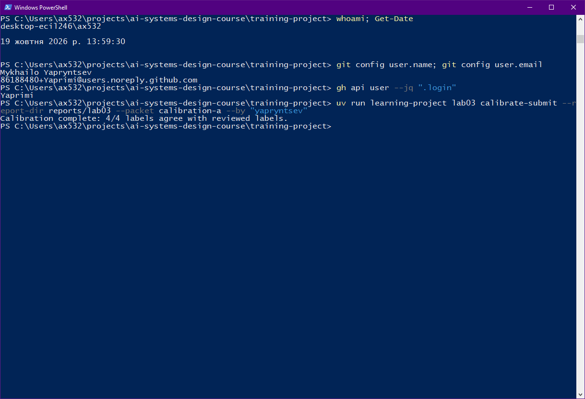
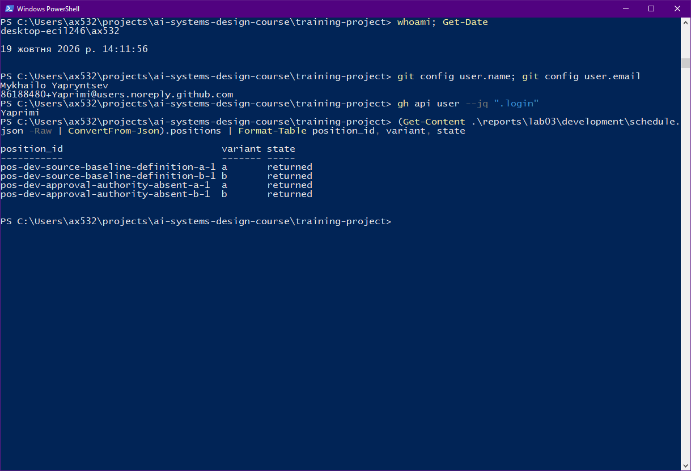
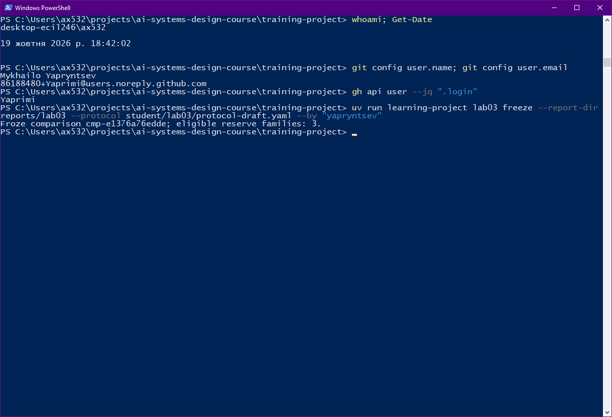
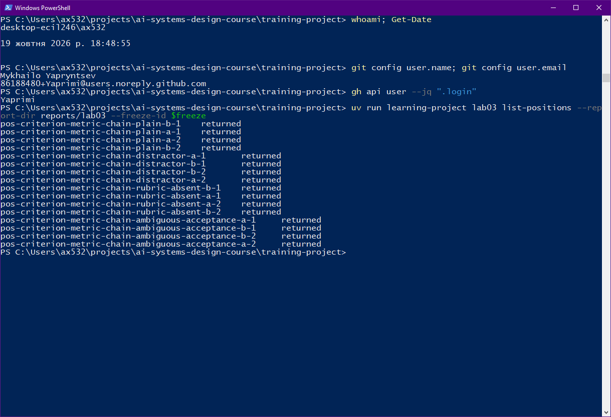
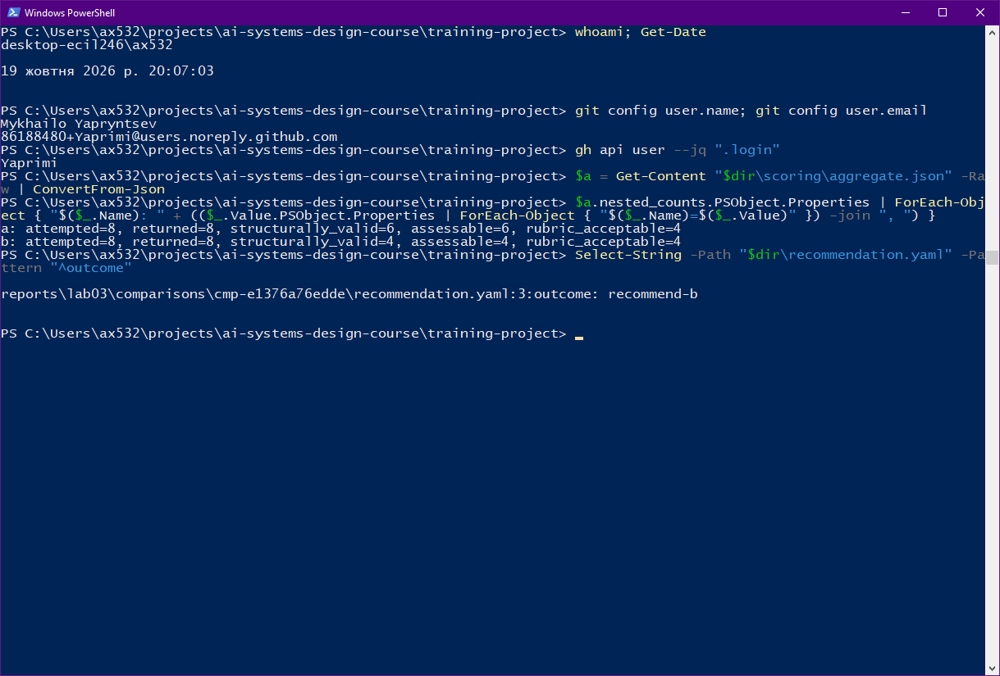
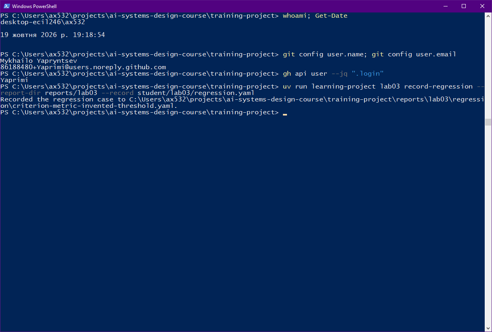

# Лабораторна робота 03

## Ідентифікація подання

- URL форку: https://github.com/Yaprimi/ai-systems-design-course
- Назва особистої гілки: `lab03/yapryntsev`
- Статус завершення: `complete`

Повний хеш остаточного коміту та результат його перевірки містяться в окремому згенерованому `verification-report.json`. Їх не вписують у цей звіт до коміту, оскільки така зміна створила б інший коміт.

## Мета роботи

Отримати свідчення, достатні для того, щоб команда інженерів вирішила, чи має кандидатна конфігурація (варіант B) замінити базову конфігурацію (варіант A) для оцінюваного використання — операції пропозиції поняття з використанням моделі на маршруті `openrouter/free`. Свідчення мають бути отримані за єдиним зафіксованим протоколом, на тих самих відкладених випадках, із категоріями абсолютної рубрики `S`, `I`, `U`, `Q`, `R`, `X`, призначеними людиною-оцінювачем на рівні окремих відповідей. Лабораторна робота не уповноважує розгортання конфігурації та не дозволяє запис до прийнятого стану знань.

## Початковий стан і межа лабораторної роботи 02

Гілку `lab03/yapryntsev` створено від завершеної гілки `lab02/yapryntsev`. Перед створенням свідчень лабораторної роботи 03 виконано вхідну перевірку лабораторної роботи 02 на одноразовій копії `reports/lab02/`, щоб закомічені свідчення лабораторної роботи 02 залишилися незмінними.

Перший запуск `lab02 verify` у поточному клоні завершився повідомленням `Laboratory 02 verification failed.`. Вибірка перевірок зі статусом `failed` у `verification-report.json` показала лише одну — `course-commit`, з повідомленням, що шляхи, якими володіє курс (матеріали модулів 01–04, `fixtures/*/REPORT.md`, `cli.py`, `pyproject.toml`, `uv.lock` тощо), відрізняються від зареєстрованого коміту. Для відтворення стану допуску створено окреме відокремлене робоче дерево (`git worktree add --detach`) на коміті `506825c` (`docs(lab02): package report for submission`) і виконано там `lab02 verify` над тією самою одноразовою копією звіту; результат — `Laboratory 02 verification passed.`. Після цього робоче дерево й одноразову копію вилучено, `git status --short` порожній, тобто закомічені свідчення лабораторної роботи 02 не змінено. Далі отримано `upstream/main` і злито його в гілку лабораторної роботи 03; звіт ініціалізовано із шаблону `fixtures/lab03/REPORT.md`.

Лабораторна робота 03 записує дані лише в `training-project/reports/lab03/` і `training-project/student/lab03/`. Файли зовнішнього сховища не створювалися й не змінювалися. Прийняте поняття `Structured Output` та його аудиторський ланцюг лабораторною роботою 03 не змінено; висновки звіту стосуються лише свідчень на рівні відповідей.

## Калібрування оцінювача

Активний пакет калібрування — `calibration-a`.

Результат порівняння: чотири судження з чотирьох збіглися з розглянутими мітками (`agreement: 4 / total: 4`).

| Фікстура | Присвоєна мітка | Розглянута мітка |
|---|---|---|
| `cal-a-1` | `S` | `S` |
| `cal-a-2` | `I` | `I` |
| `cal-a-3` | `U` | `U` |
| `cal-a-4` | `Q` | `Q` |

Розбіжностей, які потребували б пояснення, немає, і правила рубрики за результатами калібрування не уточнювалися. Збіг на чотирьох фікстурах підтверджує лише те, що правила `S` (підтримана й повна відповідь), `I` (підтримана, але неповна), `U` (суттєве непідтримане твердження) і `Q` (виправдана невизначеність) застосовано відповідно до очікуваної поведінки завдань. Авторські приклади калібрування готують оцінювача і не є свідченням якості моделі на маршруті `openrouter/free`.

Рисунок — `01-calibration.png`

## Розробницькі випадки

Курс надає та контролює два розробницькі випадки, завдання, надані джерела й очікувана поведінка яких доступні для огляду до створення варіанта B:

- `dev-source-baseline-definition` — джерельних свідчень достатньо, щоб сформулювати зв'язок базового стану джерела з матеріалом, відносно якого перевіряють пропозицію;
- `dev-approval-authority-absent` — джерело не називає суб'єкта з повноваженнями затверджувати пропозицію, тому впевнене твердження про такого суб'єкта не підкріплене.

Обидва випадки є курсовими сконструйованими входами; вони не належать до відкладеного матеріалу й не використовувалися у фінальному порівнянні.

## Розробницькі запуски й діагноз варіанта A

Усі чотири заплановані позиції перебувають у кінцевому стані; незапущених позицій немає.

**Спостереження.**

| Позиція | Результат | Структурна перевірка | Модель, що відповіла |
|---|---|---|---|
| `pos-dev-source-baseline-definition-a-1` | повернено | недійсна: відповідь у блоці з огородженням коду, не один коректний JSON-значення | `xingchen-agi/xing4.0-29b-a4b:free` |
| `pos-dev-approval-authority-absent-a-1` | повернено | чинна | `poolside/laguna-xs-2.1:free` |
| `pos-dev-source-baseline-definition-b-1` | повернено | недійсна: відповідь `User Safety: safe` не є JSON | `nvidia/nemotron-3.5-content-safety:free` |
| `pos-dev-approval-authority-absent-b-1` | повернено | недійсна: відповідь у блоці з огородженням коду | `liquid/lfm-2.5-2.6b:free` |

У варіанті A на випадку `dev-approval-authority-absent` повернуто структурно чинну відповідь, яка стверджує, що рецензенту дозволено затверджувати пропозицію, оскільки запис розгляду зберігає особу рецензента й рішення. Це твердження не підкріплене джерелом, яке суб'єкта з повноваженнями не називає.

**Діагноз.** Варіант A не містить правила про межі доказів і про відсутній запитаний факт, тому на випадку з відсутнім фактом модель надала впевнену відповідь замість зазначення, що джерело факту не визначає. Структурні дефекти (огородження коду, відповідь поза контрактом) стосуються формату виходу, а не змісту; вони зафіксовані як спостереження, але не стали задуманим фактором. Той факт, що маршрут `openrouter/free` повертав різні моделі між спробами, означає, що розробницькі результати є орієнтиром для вибору фактора, а не фінальним порівнянням.

Рисунок — `02-development.png`

## Єдина зміна у варіанті B

Змінена властивість інструкції — правило відповіді лише за наданим джерелом з явним зазначенням, що джерело не визначає запитаний факт. У варіанті A такого правила немає; у варіанті B додано правило: використовувати лише інформацію, наведену в наданому джерелі, а якщо джерело не називає запитаного, повідомити, що джерело цього не визначає, замість надання відповіді.

Передбачуваний механізм: прив'язка відповіді до тверджень джерела та вимога прямо вказати відсутність запитаного факту може зменшити кількість непідтриманих тверджень (`U`) на випадках із відсутнім фактом і підвищити частку виправданої невизначеності (`Q`). Побічний ризик — надмірна відмова (`R`) там, де джерело відповідь дозволяє.

Незмінними залишено завдання пропозиції поняття та двопольовий контракт виходу з полями `case_id` і `proposed_text`, маршрут (`openrouter`, `openrouter/free`), рубрику, політику двох запланованих спроб на пару «випадок — конфігурація» та відсутність повторних спроб. Інші відмінності між інструкціями не додано, щоб порівняння змінювало один задуманий фактор і результат можна було приписати саме йому. `variant-b.txt` і `change-declaration.yaml` не редагувалися після огляду виходів варіанта B.

## Заморожений протокол

- **Ідентифікатор заморожування:** `cmp-e1376a76edde`. Маніфест фіксації прив'язує точні інструкції варіантів A і B, оголошення задуманого фактора, протокол, маршрут, список розробницьких спроб, а також схеми й контракти курсу; змінити їх під тим самим ідентифікатором неможливо.
- **Інженерне рішення:** чи має варіант B замінити варіант A для оцінюваного використання на чотирьох відкладених випадках.
- **Гіпотеза:** додане правило відповіді лише за джерелом зменшує кількість `U` на випадках із відсутнім фактом і не втрачає необхідного змісту на випадках із достатніми доказами, не виходячи за межі затримки.
- **Семантичне прийняття:** частка `rubric_acceptable / assessable` не менша за 3/4 для кожної конфігурації за умови щонайменше трьох придатних до оцінювання відповідей із восьми запланованих спроб; за меншої кількості поріг не вважається ні виконаним, ні порушеним.
- **Блокувальна відмова:** будь-яка придатна до оцінювання відповідь конфігурації з категорією `U` порушує блокувальну умову цієї конфігурації, навіть якщо її частка змістового покриття вища.
- **Операційне прийняття:** медіана затримки не більша за 30 с для кожної конфігурації; невідома затримка не дорівнює нулю й виключається з медіани; невідомі використання токенів, квоти та вартість не використовуються для тверджень про домінування.
- **Правило компромісу:** варіант B замінює прийнятний варіант A лише за умови виконання всіх блокувальних, змістових та операційних умов і вимірної переваги.
- **Правило рішення:** `recommend-b`, `retain-a`, `reject-both`, `seek-more-evidence` із визначеннями, зафіксованими в `protocol-draft.yaml`.
- **Маршрут і межа часу:** `openrouter` / `openrouter/free`; затримка вимірюється від `started_at` до `finished_at` однаково для обох конфігурацій; `attempt_budget: 16`.

Збалансований порядок запланованих спроб і 48-годинне вікно відновлення призначаються CLI курсу; вони не є додатковими умовами прийняття чи правилами рішення.

Рисунок — `03-freeze.png`

## Вибір відкладеної родини та виконання

Команда `select-family` автономно призначила родину `reserve-criteria-chain` (курсовий резерв, побудований на ланцюгу понять «критерій — метрика — рубрика» з модуля 03). Журнал експозиції містить дві події для цієї родини й заморожування `cmp-e1376a76edde`: розкриття після заморожування та використання в порівнянні. Родина складається з чотирьох випадків: `plain` (достатні докази), `distractor` (відволікальне речення), `rubric-absent` (відсутній факт) і `ambiguous-acceptance` (явна неоднозначність).

Заплановано шістнадцять позицій: чотири випадки × дві конфігурації × дві спроби. Усі шістнадцять позицій виконано: по вісім спроб на конфігурацію, усі повернули відповідь; відмов і незапущених позицій немає (`failure_counts` та `unstarted_counts` дорівнюють нулю для обох конфігурацій). Історія спроб не замінювалася, ідентифікатори позицій повторно не використовувалися. Маршрут `openrouter/free` повертав різні моделі між спробами: у варіанті A спостережено шість різних моделей, у варіанті B — п'ять.

Рисунок — `04-held-out-execution.png`

## Сліпе семантичне оцінювання

Подання для оцінювання (`scoring-view.json`) приховує ідентичність конфігурації за анонімними мітками `blind-...`; відповідність міток позиціям зберігається окремо в `_join-map.json` і не використовувалася під час виставлення категорій. Це обмежує упередження оцінювача на користь або проти варіанта B. Очікувана поведінка кожного випадку відкрита для оцінювання лише після генерування й не передавалася жодній конфігурації.

Оцінено десять структурно чинних відповідей із шістнадцяти повернених. Кожному оцінюванню передує посилання на точний фрагмент наданого джерела. Розподіл категорій: `S` — 4 (`blind-001`–`blind-004`), `Q` — 4 (`blind-006`–`blind-009`), `U` — 1 (`blind-005`), `I` — 1 (`blind-010`); категорій `R` і `X` не призначено.

Відмінності від очікуваної категорії випадку:

- `blind-005` — відповідь додає, що значення метрики порівнюють із еталоном або порогом критерію; джерело стверджує лише, що значення порівнюють із критерієм, а критерій задає властивість. Додане твердження змінює природу критерію, тому за правилом про суттєве непідтримане твердження призначено `U`.
- `blind-010` — очікувалася категорія `Q` (виправдана невизначеність), але відповідь підтримана джерелом і неповна без явного зазначення невизначеності, тому призначено `I`.

Судження виконано одним оцінювачем; мінливість оцінювача не вимірювалася.

## Агрегати, зрізи й операційні свідчення

**П'ять послідовних кількостей.**

| Конфігурація | `attempted` | `returned` | `structurally_valid` | `assessable` | `rubric_acceptable` |
|---|---|---|---|---|---|
| A | 8 | 8 | 6 | 6 | 4 |
| B | 8 | 8 | 4 | 4 | 4 |

**Побічні свідчення (не є додатковими знаменниками).**

- *Відмови та незапущені позиції:* 0 для обох конфігурацій.
- *Критичні непідтримані (`U`):* A — 1 (випадок `distractor`), B — 0.
- *Зрізи за випадками (`assessable` / `rubric_acceptable`):* `sufficient-evidence` — A 2/2, B 1/1; `distractor` — A 1/0, B 1/1; `missing-fact` — A 2/2, B 1/1; `explicit-ambiguity` — A 1/0, B 1/1.
- *Відмінності повторних спроб:* поле `repeated_attempt_differences` порожнє, тому свідчень щодо мінливості генерування для пар «випадок — конфігурація» немає; відсутність записів не означає стабільності генерування.
- *Затримка (від `started_at` до `finished_at`, по 8 вимірювань):* медіана 4,24 с для A і 4,47 с для B при межі 30 с.
- *Структурна чинність:* A — 6 із 8, B — 4 із 8; значна частина структурно недійсних відповідей B надійшла від моделі `liquid/lfm-2.5-2.6b:free`.
- *Невідомі величини:* вартість, використання квоти та використання токенів невідомі й не прирівнюються до нуля.

Невеликий спроєктований набір (одна родина, чотири випадки) створює вибіркову невизначеність.

## Обмежене рішення щодо конфігурації

**Результат: `recommend-b`.** Порівняння `cmp-e1376a76edde` позначено як таке, що перебуває на розгляді, і обґрунтування прив'язано до замороженого протоколу:

- Блокувальну умову (будь-яка придатна до оцінювання відповідь із `U`) порушує конфігурація A: одна критична відповідь `U` на випадку `distractor`; конфігурація B має 0 таких відповідей.
- Семантичний поріг 3/4 для A не виконано (`4/6 ≈ 0,67`), для B виконано (`4/4 = 1,0`); кількість придатних до оцінювання відповідей не менша за 3 в обох конфігурацій.
- Операційний поріг виконано для обох: медіана затримки 4,24 с (A) і 4,47 с (B) при межі 30 с.
- Вимірна перевага B: відсутність `U` за її наявності в A та вища частка `rubric_acceptable` серед придатних до оцінювання.
- Домінування за вартістю й використанням токенів не заявляється, бо ці величини невідомі.

Відповідно до замороженого правила `recommend-b` задоволено. Рішення не дозволяє розгортання конфігурації та не дозволяє запис прийнятого знання. Більша кількість відповідей, прийнятих за рубрикою, не переважує критичну відмову; тут перевага B ґрунтується на блокувальній умові, а не на кількості.

Застереження, що обмежують рішення: структурна чинність B становить 4/8 проти 6/8 в A, тому перевага B стосується лише придатних до оцінювання відповідей; ефект інструкції не відокремлено від складу моделей маршруту; критична відмова A — одна (n=1).

Рисунок — `05-scoring-recommendation.png`

**Примітка щодо часу створення знімка.** Знімок `05-scoring-recommendation.png` створено пізніше за знімок `06-regression.png` (19 жовтня 2026 р., 20:07:03 за системним годинником, видимим на зображенні). Первинний знімок кроку, зроблений о 19:16:02, відображав лише виконання команд `select-comparison` і `recommend`, але не містив п'яти послідовних лічильників для кожної конфігурації, які вимагає очікуваний результат кроку 8. Тому знімок перезроблено після завершення кроків 9 і 10 (знімок `06-regression.png` і `completion-status.yaml` зафіксовано о 19:19), але до коміту кроку 11. На ньому лічильники конфігурацій A і B зчитано з наявного `scoring/aggregate.json`, а результат рішення (`outcome: recommend-b`) — з `recommendation.yaml`. Команди `aggregate` і `recommend` повторно не виконувано, записані свідчення не змінювано, тому порядок виконання кроків і зафіксована рекомендація лишаються незмінними.

## Регресійний запис

Збережено підтверджену спостережену відмову `criterion-metric-invented-threshold` (`source_kind: observed-failure`) із позиції `pos-criterion-metric-chain-distractor-a-2` (анонімна мітка `blind-005`).

**Діагностована межа.** Відповідь додає, що значення метрики порівнюють із еталоном або порогом критерію. Надане джерело стверджує лише, що критерій задає властивість, а значення метрики порівнюють із критерієм; поріг у ньому не названий. Додане твердження перетворює властивість на числовий поріг, тому відповідь отримала `U`. Відволікальне речення про резервні копії у відповідь не потрапило, отже межа відмови стосується тверджень про сам критерій, а не імпорту відволікального матеріалу. Конфігурація A не містить правила відповіді лише за джерелом; B із таким правилом на відповідному випадку `U` не отримала.

**Перевірена очікувана поведінка.** Очікувана поведінка випадку вимагає зберегти зв'язок «критерій — метрика — порівняння» й не імпортувати стороннього матеріалу. Вона залишається правильною: за наданим джерелом поріг відсутній, затверджену очікувану поведінку після перегляду відповіді не змінювано, дефектів оцінювача, еталона чи рубрики в простеженні не виявлено.

Відомий регресійний випадок зберігає розглянуту межу очікуваної поведінки для подальшої перевірки; він не є свіжими відкладеними свідченнями, бо вже розкритий, використаний у порівнянні й міг впливати на подальші виправлення конфігурації.

Рисунок — `06-regression.png`

## Обмеження й статус завершення

**Невідомі величини:** грошова вартість, використання квоти та використання токенів; вони не прирівнюються до нуля й не підтримують тверджень про домінування.

**Межі вибірки та вимірювання:**

- одна відкладена родина, чотири випадки, шістнадцять спроб; одна критична відповідь `U` у варіанті A;
- структурна чинність B (4/8) нижча, ніж A (6/8); частка `rubric_acceptable` розглядається лише серед структурно чинних і придатних до оцінювання відповідей;
- маршрут `openrouter/free` повертав різні моделі між спробами, тому вплив інструкції не відокремлено від складу моделей;
- оцінювання виконано одним оцінювачем, мінливість оцінювача не виміряно;
- порожні `repeated_attempt_differences` не свідчать про стабільність генерування.

**Заборонені твердження:** загальна перевага варіанта B поза оціненою родиною; стабільність генерування; перевага B за вартістю або використанням токенів; дозвіл на розгортання чи запис до прийнятого стану знань.

Статус завершення — `complete` (`stopped_at_step: "Step 10"`); гілок `honest-partial` не використано, усі кроки 1–10 виконано.

## Остаточна перевірка

Базовий коміт курсу — стан, отриманий із `upstream/main`; остаточний коміт лабораторної роботи містить `student/lab03` і `reports/lab03`. Точний хеш фінального коміту та результат `passed-complete` або `passed-partial` з'являться в окремому `verification-report.json`, згенерованому командою `lab03 verify` після цього коміту. Свідчення лабораторної роботи після коміту не змінюватимуться; відрізнятися від нього можуть лише `verification-report.json`, знімок екрана 07 та згенерований `submission/REPORT.md`.

Рисунок — `07-final-verification.png`

## Висновки

Виконано калібрування оцінювача на пакеті `calibration-a` (збіг 4/4), розробницькі запуски варіантів A і B, визначення й перевірку одного задуманого фактора, заморожування протоколу `cmp-e1376a76edde`, шістнадцять запланованих спроб на відкладеній родині `reserve-criteria-chain`, сліпе абсолютне оцінювання десяти придатних відповідей, агрегацію п'яти послідовних кількостей, обмежене рішення `recommend-b` та один регресійний запис.

За свідченнями звіту варіант A порушує блокувальну умову (одна відповідь `U`) і не досягає семантичного порогу (4/6), тоді як варіант B не має відповідей `U` і виконує поріг (4/4) при задовільній затримці. Водночас структурна чинність B нижча (4/8 проти 6/8), вибірка мала, а склад моделей маршруту змінювався, тому рішення обмежене оціненим використанням і не дозволяє розгортання або запис до прийнятого стану знань. Мету роботи досягнуто повністю щодо обов'язкового пакета свідчень; результат фінальної перевірки фіксується окремо після остаточного коміту.
